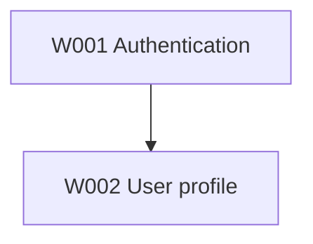

# Project documentation conventions

Keep global contracts short and factual:
- `prd.md`: vision, users, capabilities, non-goals, cross-cutting product rules.
- `engineering.md`: current system boundaries, relevant stack, style, testing/CI and architectural decisions. Distinguish current reality from desired design.
- `progress.md`: current focus, completed/blocked/pending work-items, last validation, next action. This is a summary, not a task database.
- `graph.md`: Mermaid DAG of work-item dependencies plus short legend. Dependency declarations live in each work-item's `requirements.md`; keep this graph synchronized.

On bootstrap, learn from code and user intent rather than inventing product facts. Keep unknowns explicit and ask only for blocking decisions.

Example work-item:
```
.flow/work-items/W001-user-authentication/
  requirements.md
  design.md
  tasks.md
```

Requirements should contain title/outcome, depends-on IDs, behavioral scenarios and measurable acceptance criteria. Design should contain relevant architecture, affected boundaries, testing strategy and material tradeoffs, referring to global engineering rather than copying it. Tasks should contain W###-T### identifiers, dependencies, checkboxes, validation and concise status. Only mark a task complete after its single coherent Git commit is reachable and checks pass.

Suggested task:
```md
- [ ] W001-T001 — Implement password validation
  - Depends on: none
  - Verify: tests for valid, invalid and boundary cases
```

Suggested graph:


Avoid opaque YAML state machines, generated projections, duplicate acceptance criteria, mandatory CLI routing and version-based migrations.
